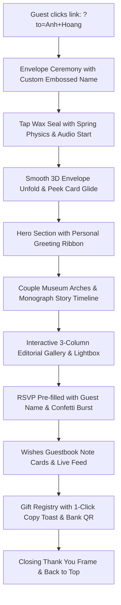

# Nam & Hiệp Wedding — Experience & Interaction Specification

## 1. Guest Journey Architecture

## 2. Dynamic Personalization Logic
- Query Parameter Schema:
  - `?to=<GuestName>`
  - `?guest=<GuestName>`
  - `?name=<GuestName>`
- Default fallback:
  - VI: `Quý Khách & Gia Đình`
  - EN: `Valued Guest & Family`
- Surface Touchpoints:
  1. **Envelope Cover**: Foil embossed name tag with gold shimmer.
  2. **Hero Section**: Dedicated welcome ribbon honoring the guest.
  3. **RSVP Form**: Pre-populates the Guest Name input so the guest doesn't need to retype their name.

## 3. Cinematic Micro-Animations
- **Floating Petals Component**: Gentle particle canvas with wind vector swaying, rendering soft petals & glowing bokeh.
- **Audio Equalizer Visualizer**: Visual indicator on the music button showing active harmony.
- **Wax Seal Ceremony**: Realistic tactile feedback on open.
